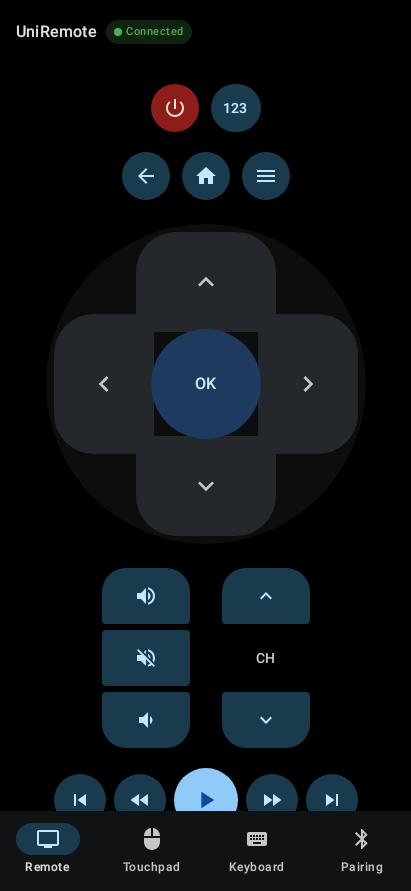

# UniRemote

UniRemote turns an Android phone or tablet into a capable TV remote. It uses Bluetooth
Classic HID, so the phone behaves like a keyboard, mouse, and consumer-control
peripheral—no companion app or Wi-Fi setup is required on the TV.



## Features

- D-pad, Back, Home, Menu, volume, channel, media, numeric, and power controls
- Touchpad with primary/secondary click, scrolling, and adjustable speed
- Keyboard text input and quick editing keys
- Bluetooth pairing and saved TVs
- Capability-aware controls: unsupported actions are hidden or disabled instead of being
  sent to a TV that cannot use them
- Responsive layouts for phones, tablets, foldables, and landscape use

## Supported TVs

Android TV, Google TV, Fire TV, Samsung, LG, and other TVs that accept a Bluetooth
keyboard/mouse. Pair the phone from the TV's accessory settings, then select the paired TV
in UniRemote.

Roku is not supported: it does not accept a generic Bluetooth HID peripheral.

TV firmware, settings, and manufacturer behavior ultimately determine which controls work;
validate the intended hardware before treating a TV as supported.

## Get started

1. Install UniRemote on an Android 9 (API 28) or newer device with Bluetooth.
2. Open **Pairing** and grant the requested Bluetooth and notification permissions.
3. Put the TV into its “add accessory” / Bluetooth keyboard pairing mode, pair the phone,
   then select it under **Paired Bluetooth Devices**.
4. Use the Remote, Touchpad, and Keyboard tabs.

## Build from source

### Requirements

- JDK 21 for the checked-in Gradle daemon configuration
- Android SDK Platform 35 / Build Tools installed through Android Studio or `sdkmanager`
- An Android device or emulator running API 28 or later

```sh
git clone <repository-url>
cd UniRemote

./gradlew assembleDebug
```

The debug APK is written to `app/build/outputs/apk/debug/`.

### Quality checks

```sh
./gradlew test                  # JVM unit tests across all modules
./gradlew lintDebug             # Android lint
./gradlew verifyRoborazziDebug  # Compose screenshot regression tests
./gradlew assembleDebug         # Debug APK
./gradlew :app:connectedDebugAndroidTest  # Device-backed pairing journey
```

The journey test requires a connected device or emulator. It connects a saved Bluetooth TV
from the Pairing tab and sends a key from the Remote tab.

The Gradle daemon is pinned to JDK 21 in
[`gradle/gradle-daemon-jvm.properties`](gradle/gradle-daemon-jvm.properties). If you change
that file, stop the daemon before the next build:

```sh
./gradlew --stop
```

## Project structure

```text
:app                  Application entry point and responsive Compose shell
:feature:pairing      Device discovery, saved TVs, and connection UI
:feature:remote       Remote-control surface
:feature:touchpad     Pointer and scroll controls
:feature:keyboard     Text input controls
:data:session         Transport selection, persistence, and session lifecycle
:transport:api        Transport contracts and capability vocabulary
:transport:bthid      Bluetooth Classic HID implementation
:core:model           Shared targets, keys, and pointer models
:core:ui              Reusable controls, theme, and adaptive layout utilities
```

Features depend on `:data:session`, not the concrete transport. The UI reacts to the
transport's declared capabilities without hard-coding brand-specific behavior.

## Hardware validation

Automated tests cannot confirm a TV's Bluetooth pairing UX, vendor API prompts, or cold boot
behavior. Before a release, run the physical-device checklist in
[`docs/hardware-validation.md`](docs/hardware-validation.md) for every target TV and record
the model and firmware tested.

## Known limitations

- Bluetooth HID supports one active host connection in practice.
- Roku is not supported; it does not accept the generic Bluetooth HID profile.
- No cold power-on: a TV with its Bluetooth radio off cannot be woken over HID.
- Bluetooth HID text input is limited to characters representable by a hardware keyboard.

## License

Copyright 2026 UniRemote contributors. Licensed under the
[Apache License 2.0](LICENSE).
